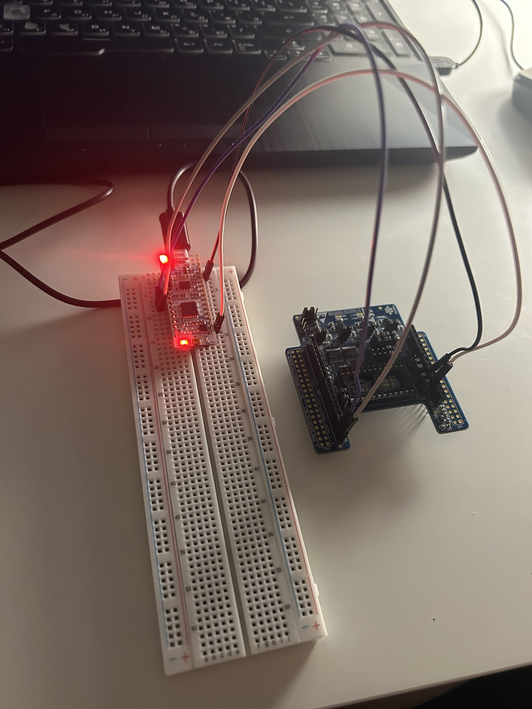
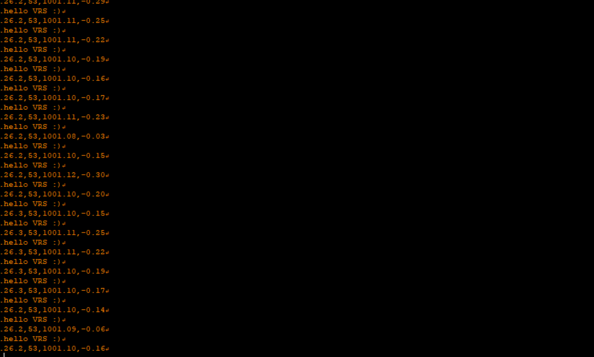
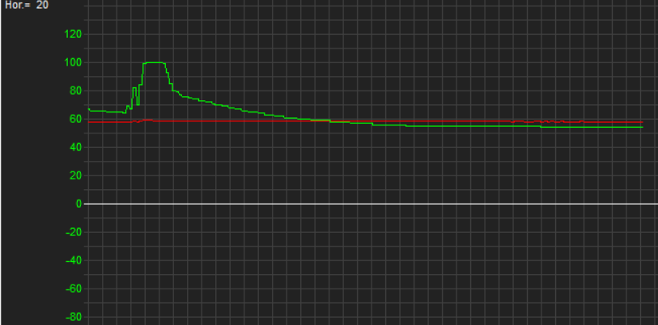

# STM32 Environmental Sensors

Reading temperature, humidity, pressure and relative altitude from MEMS sensors over **I2C** on an **STM32F303K8** (LL drivers), with **CSV** output over USART for live plotting.

<p align="center">
  
</p>

## Hardware

| Board | Role |
|---|---|
| NUCLEO-F303K8 | MCU (ARM Cortex-M4), I2C master |
| X-NUCLEO-IKS01A2 | sensor board |
| HTS221 | temperature + relative humidity |
| LPS22HB | absolute pressure |

### Wiring

| IKS01A2 | NUCLEO-F303K8 | STM32 pin |
|---|---|---|
| SCL | D5 | PB6 (I2C1_SCL) |
| SDA | D4 | PB7 (I2C1_SDA) |
| 3V3 | 3V3 | – |
| GND | GND | – |

I2C1: 100 kHz standard mode, internal pull-ups on PB6/PB7.
 


The sensor drivers do not call `i2c.c` directly. `main.c` passes the I2C read/write functions to them as callbacks:

```c
hts221_init(i2c_master_read, i2c_master_write);
lps22hb_init(i2c_master_read, i2c_master_write);
```

### I2C driver (`Core/Src/i2c.c`)
- `i2c_master_read()` – register address + repeated start + N-byte read (RX interrupt)
- `i2c_master_write()` – register address + N data bytes in one transfer
- NACK detection, so a missing sensor returns an error instead of hanging

### HTS221 driver
- init: `WHO_AM_I` check (`0xBC`), configuration (`CTRL_REG1 = 0x85`: active, BDU, 1 Hz), reading factory calibration
- `hts221_get_temperature()`, `hts221_get_humidity()` – linear interpolation using the calibration coefficients

### LPS22HB driver
- init: `WHO_AM_I` check (`0xB1`), configuration (`CTRL_REG1 = 0x2A`: 10 Hz, low-pass filter, BDU)
- `lps22hb_get_pressure()` – 24-bit value read in one transfer, `raw / 4096` → hPa
- `lps22hb_get_altitude()` – post-processing: relative altitude from the barometric formula

```
h = 44330 · (1 − (p / p0)^(1/5.255))
```
`p0` is the pressure measured at start-up, so the altitude is relative to the starting point.

## Output

CSV over USART2 (ST-LINK virtual COM port, 38400 baud, 8N1):

```
temperature [°C], humidity [%], pressure [hPa], altitude [m]
26.2,53,1001.10,-0.16
```

Received data in [Serial Oscilloscope](https://x-io.co.uk/serial-oscilloscope/):

<p align="center">
  
</p>

### Humidity test

Breathing on the HTS221 sensor: humidity jumps to 100 % and then slowly returns to the room level.

<p align="center">
  
</p>

